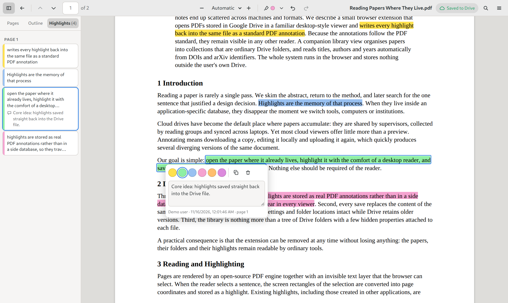

<p align="center">
  
</p>

<h1 align="center">Paper Library</h1>

<p align="center">
  <b>Read, highlight and organise the research papers in your Google Drive or OneDrive,<br>
  with a desktop-style PDF viewer and a Mendeley-style library, right in Chrome.</b>
</p>

<p align="center">
  Highlights are saved <i>into the PDF itself</i>, on the <i>same cloud file</i>.<br>
  Collections are plain folders. No server, no tracking, and your papers never leave your own cloud.
</p>

<h3 align="center">🌐 <a href="https://prajwalsingh.github.io/paper-library/">prajwalsingh.github.io/paper-library</a></h3>
<p align="center"><i>Features, interactive install guide, privacy checker, FAQ and release history.</i></p>

<p align="center">
  <a href="https://prajwalsingh.github.io/paper-library/#install">Install</a> ·
  <a href="docs/SETUP.md">Google setup</a> ·
  <a href="docs/SETUP-ONEDRIVE.md">OneDrive setup</a> ·
  <a href="docs/SECURITY.md">Security</a> ·
  <a href="docs/PRIVACY.md">Privacy</a> ·
  <a href="docs/DEVELOPMENT.md">Development</a>
</p>

> [!TIP]
> **🆕 Latest version: [v2.2.0](docs/releases/v2.2.0.md), updated 16 November 2026.**
> **Supplementary reading mode:** attach supplementary files (PDFs, figures, data tables, text, videos) to a paper and
> read them **side by side** with it. [v2.1.0](docs/releases/v2.1.0.md) shows which collections a paper is in;
> [v2.0.0](docs/releases/v2.0.0.md) added **OneDrive** and **Delete forever**.
>
> **Installed an older copy?** Check your version in `chrome://extensions`, then run `git pull` in your
> Paper Library folder and click **⟳** on the *Paper Library* card. Your library, highlights and client IDs stay as they are.
> [How to update](#updating) · [All release notes](docs/releases/)

> [!IMPORTANT]
> **The only official source is this repository: <https://github.com/prajwalsingh/paper-library>.**
> Paper Library is **not** published on the Chrome Web Store or anywhere else. Any copy offered
> elsewhere is unofficial, so please don't install it. [Why GitHub only?](docs/SECURITY.md#1-official-source-github-only)

---



## What it does

- 📖 **A real PDF reader for your cloud files:** thumbnails, outline, find, zoom, light/dark theme.
- 🖍️ **Highlights and notes in six colours, saved inside the PDF** as standard annotations, on the same file. They open in any PDF reader.
- 📚 **A Mendeley-style library** whose collections are plain folders, with details filled in automatically from DOI / arXiv.
- 📎 **Supplementary reading mode:** attach a paper's supplementary files and read them side by side with it: PDFs (highlightable), figures, CSV/TSV tables, text and videos.
- ☁️ **Google Drive or OneDrive** (personal, work or school), switchable in Settings.
- 📝 **Export highlights and notes as Markdown**, for Obsidian, Notion or a literature review.
- 🔒 **No server, no tracking.** A network lock in `manifest.json` lets the extension talk only to your cloud, Crossref and arXiv.

**See everything, with screenshots, on the [website](https://prajwalsingh.github.io/paper-library/#features).**

## Install (short version)

1. **Clone** it with [git](https://git-scm.com/downloads) into a folder you'll keep. Git keeps it in sync later (see Updating):
   ```bash
   git clone https://github.com/prajwalsingh/paper-library.git
   ```
2. Open `chrome://extensions` → switch on **Developer mode** → **Load unpacked** → pick the folder with `manifest.json`.
   The extension ID is `hadmfffnocpeglonjioajbpdfbkbjekf` on every computer.
3. Click the pinned icon, choose **Google Drive** or **OneDrive**, and do the one-time sign-in setup:
   [Google guide](docs/SETUP.md) · [OneDrive guide](docs/SETUP-ONEDRIVE.md).
   You create your **own** free client ID, so the permission belongs to you. Keep that ID private.

The [website's install guide](https://prajwalsingh.github.io/paper-library/#install) walks through each step with copy buttons.

### Updating

Updates never install themselves. Run `git pull` in your Paper Library folder, then click **⟳ reload**
on the *Paper Library* card in `chrome://extensions`. Git updates the folder Chrome already uses, so nothing is replaced by hand.
Your library, highlights and client IDs stay as they are. What changed: [release notes](docs/releases/).

## Check the privacy yourself

```bash
python3 scripts/audit.py         # permissions, the network lock, every website the code can reach
python3 scripts/audit.py --libs  # bundled PDF.js and pdf-lib are byte-for-byte the official releases
```

Or try the [interactive lock checker](https://prajwalsingh.github.io/paper-library/#privacy).
Details: [SECURITY.md](docs/SECURITY.md) · [PRIVACY.md](docs/PRIVACY.md).

## Development

A demo mode runs the viewer and library with a fake cloud, no account needed:

```bash
python3 dev/serve.py   # then open http://127.0.0.1:8765/library.html
```

See [DEVELOPMENT.md](docs/DEVELOPMENT.md). The website is the single file [`docs/index.html`](docs/index.html).

## Acknowledgements

Paper Library was built together with **Claude** (Anthropic's AI assistant), working in Claude Code.
I brought the idea and the direction; Claude turned it into working code, tested every step and explained
each design decision, so I learned how and why it all works. Thank you, Claude. 🙏 — *Prajwal Singh*
([full note on the website](https://prajwalsingh.github.io/paper-library/#thanks)).

Built on [PDF.js](https://mozilla.github.io/pdf.js/), [pdf-lib](https://pdf-lib.js.org/), and the free APIs of
[Crossref](https://www.crossref.org/) and [arXiv](https://arxiv.org/).

## License

[MIT](LICENSE). Bundled libraries keep their own licenses: PDF.js (Apache-2.0, `lib/pdfjs/LICENSE`) and
pdf-lib (MIT, `lib/pdf-lib/LICENSE.md`).
