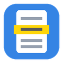
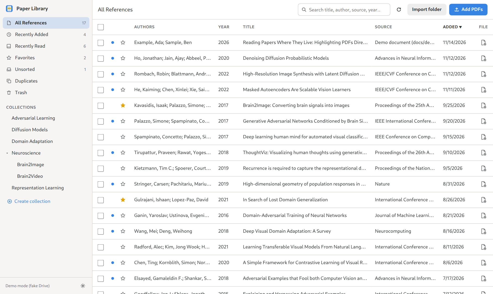
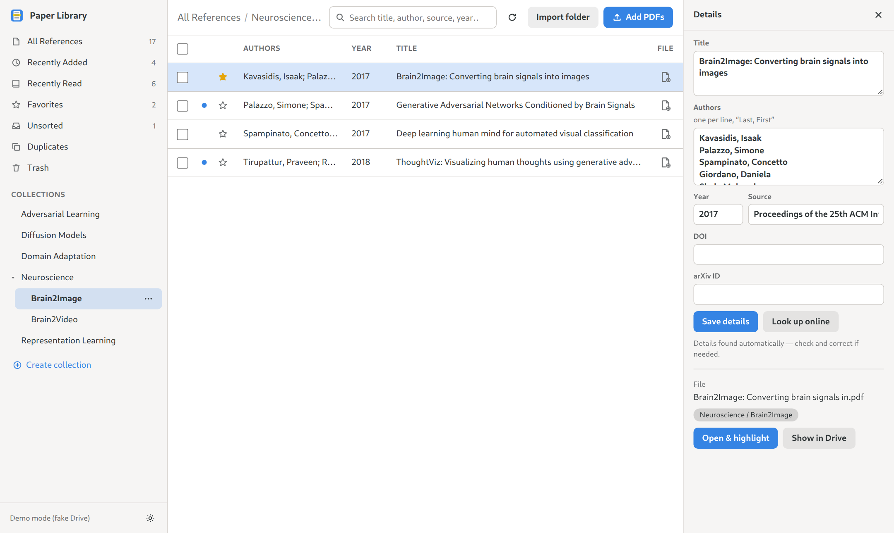
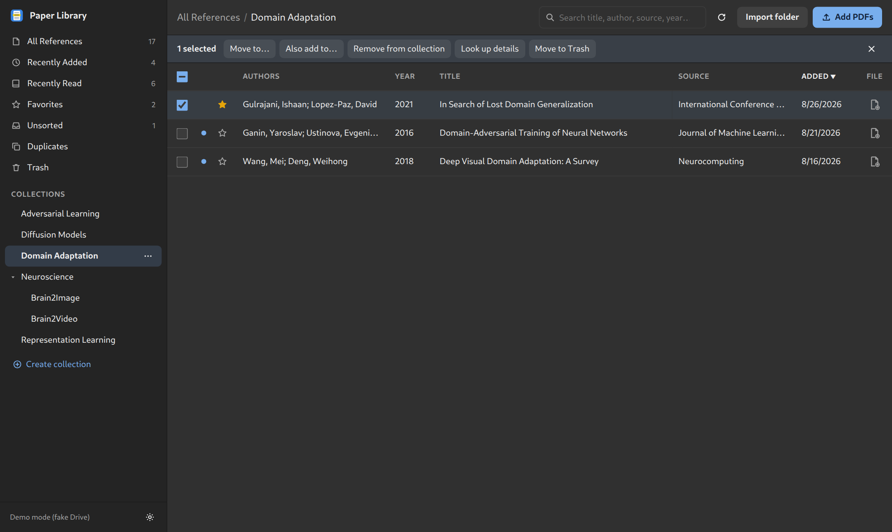
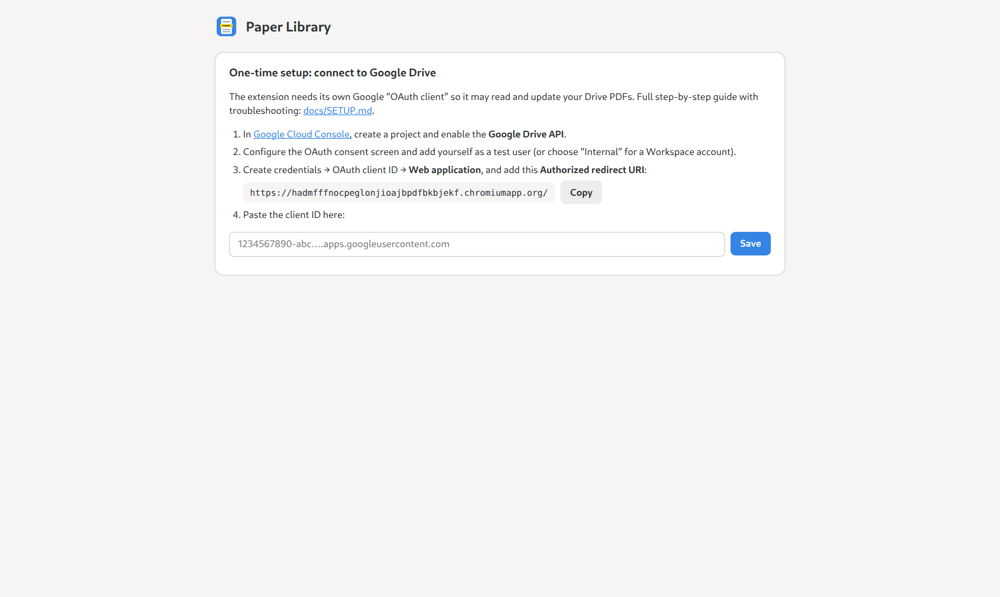

<p align="center">
  
</p>

<h1 align="center">Paper Library</h1>

<p align="center">
  <b>Read, highlight and organise the research papers in your Google Drive,<br>
  with a desktop-style PDF viewer and a Mendeley-style library, right in Chrome.</b>
</p>

<p align="center">
  Highlights are saved <i>into the PDF itself</i>, on the <i>same Drive file</i>.<br>
  Collections are plain Drive folders. No server, no tracking, and your papers never leave your Drive.
</p>

<p align="center">
  <a href="#install">Install</a> ·
  <a href="docs/SETUP.md">Google setup</a> ·
  <a href="#no-data-sharing-and-how-to-check">Privacy &amp; proof</a> ·
  <a href="#how-it-works">How it works</a> ·
  <a href="docs/DEVELOPMENT.md">Development</a>
</p>

> [!IMPORTANT]
> **The only official source is this repository: <https://github.com/prajwalsingh/paper-library>.**
> Paper Library is **not** published on the Chrome Web Store or anywhere else. Any copy offered
> elsewhere is unofficial, so please don't install it. [Why GitHub only?](docs/SECURITY.md#1-official-source-github-only)

---


## Features

### 📖 A real PDF reader for Drive files
- **Desktop look and feel:** inspired by GNOME Document Viewer, with page thumbnails, the table of contents, find (Ctrl F) and zoom.
- **Light, dark or system theme:** set it in the viewer's menu or with the theme button at the bottom of the library sidebar. It applies to every open Paper Library tab. Separately, *Night mode* darkens the PDF pages themselves.
- **Highlight in six colours:** select text and pick a colour, or press **H** for the highlighter tool.
- **Notes:** click any highlight to add a note, change its colour, copy its text, or delete it. Undo and redo work for everything.
- **Saves itself:** a few seconds after you stop, the PDF is saved back to the **same Drive file** as a new version. Links, sharing and folder location don't change.
- **Highlights are standard PDF annotations.** They show up in Adobe Reader, Evince/Okular, Zotero, Chrome's viewer and Drive's own preview. Highlights you made in those apps can be edited here too.
- **Safe saving:** if the file changed elsewhere since you opened it, you're asked before anything is overwritten. Drive keeps older versions.

### 📚 A Mendeley-style library


- **Collections and sub-collections**, which are real **folders in Google Drive** under one `Paper Library` folder.
- **Authors, year, title and source are filled in automatically** from the paper's DOI or arXiv ID, using the free Crossref and arXiv databases. You can edit them all.
- **Upload PDFs or a whole folder:** the folder becomes a collection, and its subfolders become sub-collections. You choose where it goes; **Top level** is preselected.
- **Drag and drop:** drag papers onto a collection to move them. **Also add to…** lists a paper in a second collection as a Drive shortcut.
- **Reorganise collections:** drag a collection onto another one, or onto the **COLLECTIONS** heading to make it top level. You can also use **⋯ → Move to…**. Its papers and sub-collections move with it.
- **Quick views:** Recently Added, Recently Read, Favorites (Drive's ★), Unsorted, Duplicates, and Trash (Drive's trash).
- **Search** across title, authors, source and year, and sort by any column.

| Details panel | Dark mode, papers selected |
|---|---|
|  |  |

---

## Install

Paper Library is installed straight from this repository (Chrome calls this an
"unpacked" extension). It takes about 10 minutes the first time, mostly for the
one-time Google sign-in setup.

### 1. Download

Either:
- **Download** `paper-library-vX.Y.Z.zip` from the [**latest release**](https://github.com/prajwalsingh/paper-library/releases/latest),
  optionally [check its checksum](docs/SECURITY.md#d-check-your-download), and unzip it somewhere permanent (e.g. `~/Apps/paper-library`), **or**
- **Clone** the repository:
  ```bash
  git clone https://github.com/prajwalsingh/paper-library.git
  ```

> Keep the folder after installing. Chrome runs an unpacked extension straight from that folder.

### 2. Add it to Google Chrome

1. Open **`chrome://extensions`** in the address bar.
2. Switch on **Developer mode** (top-right corner).
3. Click **Load unpacked** and select the folder that contains `manifest.json`.
4. *Paper Library* appears with ID **`hadmfffnocpeglonjioajbpdfbkbjekf`**.
   This ID is the same on every computer, which keeps the Google setup below simple.
5. Click the puzzle-piece icon in Chrome's toolbar and **pin** *Paper Library*.

It also works in other Chromium browsers that support extensions (Edge, Brave, Chromium).

### 3. Connect it to Google Drive (one time)

Click the pinned icon. A setup page opens:



Google only lets an app read and update your Drive if it has its own sign-in ID
(an *OAuth client ID*). With Paper Library, **you create your own**, for free, in a few clicks.
That means the Drive permission you grant goes to *your own* Google project, not to anyone else.
👉 **Step-by-step guide: [docs/SETUP.md](docs/SETUP.md).**

In short: create a Google Cloud project → enable the Drive API → create a
"Web application" OAuth client with the redirect URI shown on the setup page →
paste the client ID → **Sign in with Google**.

### 4. Use it

- **Toolbar icon** → opens the **library**. On a Drive file page, it opens that PDF instead.
- **On drive.google.com**, open or select a PDF and click the blue **Open in Paper Library** button (bottom right).
- **Bring your papers in:** in the library, click **Import folder** and pick a folder of PDFs.

### Updating

Updates never install themselves. You decide when to update:
download the new release (or `git pull`) into the same folder, then click the
**reload ⟳** icon on the *Paper Library* card in `chrome://extensions`.
The [releases page](https://github.com/prajwalsingh/paper-library/releases) lists what changed in each version.

---

## No data sharing, and how to check

- **No server, no analytics, no tracking.** The author receives nothing. Your papers, highlights and library details live only in **your** Google Drive.
- **Your own sign-in.** Drive access is granted to a Google project that *you* create and control. You can revoke it anytime at <https://myaccount.google.com/permissions>.
- **A network lock enforced by Chrome.** The extension's [`manifest.json`](manifest.json) contains a Content Security Policy that allows connections **only** to:

  | Destination | Why |
  |---|---|
  | `www.googleapis.com`, `oauth2.googleapis.com` | Google Drive and Google sign-in |
  | `api.crossref.org`, `export.arxiv.org` | Paper details, looked up by DOI / arXiv ID / title only (never the PDF) |

  Chrome blocks every other connection before it leaves your computer, including from the bundled libraries.

**Check it yourself:**

| How | What you'll see |
|---|---|
| Open `manifest.json` → `content_security_policy` | The four allowed websites after `connect-src` |
| Library page → right-click → **Inspect** → **Network** tab | Requests only to Google, Crossref and arXiv |
| In that **Console**, run `fetch('https://example.com')` | *"Refused to connect because it violates the document's Content Security Policy"* |
| `python3 scripts/audit.py` | Permissions, the lock, and every website and network call in the code |
| `python3 scripts/audit.py --libs` | Proof that the bundled PDF.js and pdf-lib are byte-for-byte the official releases |
| `sha256sum -c paper-library-vX.Y.Z.zip.sha256` | That your download is exactly the published release |

More detail: [docs/SECURITY.md](docs/SECURITY.md) · Privacy policy: [docs/PRIVACY.md](docs/PRIVACY.md)

---

## How it works

```
                 ┌────────────────────── your Google Drive ──────────────────────┐
                 │  Paper Library/                                                │
                 │  ├── Neuroscience/            ← collection = folder            │
                 │  │   └── paper.pdf            ← highlights inside the PDF,     │
                 │  └── Domain Adaptation/          title/authors as file props   │
                 └───────────▲──────────────────────────────┬─────────────────────┘
                             │ save (new version)            │ download
                 ┌───────────┴──────────────────────────────▼─────────────────────┐
  Chrome         │  Library page  ── open ──►  Viewer (PDF.js)                    │
  extension      │  (folders, details,          ├ highlights drawn as overlay      │
                 │   uploads)                   └ pdf-lib writes /Highlight annots │
                 └────────────────────────────────────────────────────────────────┘
```

- **Viewer.** [PDF.js](https://mozilla.github.io/pdf.js/) draws each page and an invisible text layer you select with. When a file opens, its highlights are taken out and drawn as an editable overlay. On save, [pdf-lib](https://pdf-lib.js.org/) writes them back as standard `/Highlight` annotations. Each one carries "multiply" blending, so the text stays crisp like under a real highlighter pen. The bytes are then uploaded to the **same file ID**.
- **Library.** Collections are Drive folders. Paper details are saved as hidden Drive *properties* on each PDF, so they move with the file. A paper in two collections uses a Drive shortcut, because Drive allows only one folder per file. Favorites use Drive's star, and Trash is Drive's trash.
- **Automatic details.** The first page is scanned for a DOI or arXiv ID, which is looked up in Crossref or arXiv. For papers already in Drive, PDF.js downloads only the first part of the file.
- **Sign-in.** This uses `chrome.identity.launchWebAuthFlow` with your own OAuth client. You can pick any Google account, and the short-lived token stays in your browser.

Everything stays plain Drive files and folders. **If you uninstall Paper Library, your papers, folders and highlights are all still there.**

## Keyboard shortcuts

| Viewer | | Library | |
|---|---|---|---|
| `H` | highlighter tool | `/` | search |
| `Ctrl S` | save now | `Enter` | open selected paper |
| `Ctrl Z` / `Ctrl Shift Z` | undo / redo | `Delete` | move to Trash |
| `Delete` | delete selected highlight | `Ctrl A` | select all |
| `Ctrl F` | find | `Shift`+click | select a range |
| `Ctrl +` / `−` / `0`, `Ctrl`+wheel | zoom | `Esc` | clear selection |
| `Alt ←` / `Alt →` | back / forward after a link | | |
| `F9` | sidebar | | |

## Limitations

- Encrypted or password-protected PDFs open **read-only**.
- Saving rewrites the PDF file, which **invalidates digital signatures**.
- View-only Drive files can be highlighted, but have to be saved with **Menu → Save a copy to Drive**.
- Only text highlights can be edited. Other annotations (ink, sticky notes) are shown and kept as they are.
- Automatic details work best for papers with a DOI or arXiv ID. Others fall back to the PDF's own text, and you can always fix them in the details panel.

## FAQ

**Why do I have to create a Google Cloud project?**
So the Drive permission belongs to you. Reading and updating any file in your
Drive needs Google's full Drive permission. With your own client ID, that
permission is granted to *your own* project, nobody else can use it, and Google
doesn't need to review a shared app.

**Why isn't it on the Chrome Web Store?**
On purpose. Store extensions update automatically, so a hijacked publisher
account could push malicious code to every user. GitHub installs change only when
you update them yourself. See [docs/SECURITY.md](docs/SECURITY.md).

**"Access blocked: … admin" when signing in with a university or work account?**
Your Workspace admin blocks unverified apps. Create the Cloud project inside your
organisation with **Internal** audience, or ask IT to allow your client ID. See [docs/SETUP.md](docs/SETUP.md#troubleshooting).

**Can several people share one client ID?**
Yes, up to 100. Add their Google accounts as test users. Each person's files still stay in their own Drive. See [docs/SETUP.md](docs/SETUP.md#sharing-with-friends-or-lab-mates).

**Does it work offline?** No. Files are read from and saved to Drive.

## Development

There's a demo mode that runs the viewer and the library in a normal browser tab
with a fake Drive. No Google account is needed:

```bash
python3 dev/serve.py
# open http://127.0.0.1:8765/library.html
```

See [docs/DEVELOPMENT.md](docs/DEVELOPMENT.md) for the code structure, regenerating
screenshots, and building a release.

## Acknowledgements

Paper Library was built together with **Claude** (Anthropic's AI assistant), working in Claude Code.

I brought the idea and the direction: a reader that feels like a desktop PDF app,
highlights that live inside the papers themselves, a Mendeley-style library made of
plain Google Drive folders, and privacy you can verify rather than just trust.
Claude turned those instructions into working code, tested every step, and explained
each design decision along the way, so I learned how and why it all works while
building it.

Thank you, Claude, for the patience, the careful testing, and for making a tool I
wanted for my own research real, and good enough to share. 🙏
— *Prajwal Singh*

Thanks also to the open-source projects and public services that make this possible:
[PDF.js](https://mozilla.github.io/pdf.js/) (Mozilla), [pdf-lib](https://pdf-lib.js.org/),
and the free bibliographic APIs of [Crossref](https://www.crossref.org/) and [arXiv](https://arxiv.org/).

## License

[MIT](LICENSE). Bundled third-party libraries keep their own licenses:
PDF.js (Apache-2.0, `lib/pdfjs/LICENSE`) and pdf-lib (MIT, `lib/pdf-lib/LICENSE.md`).
