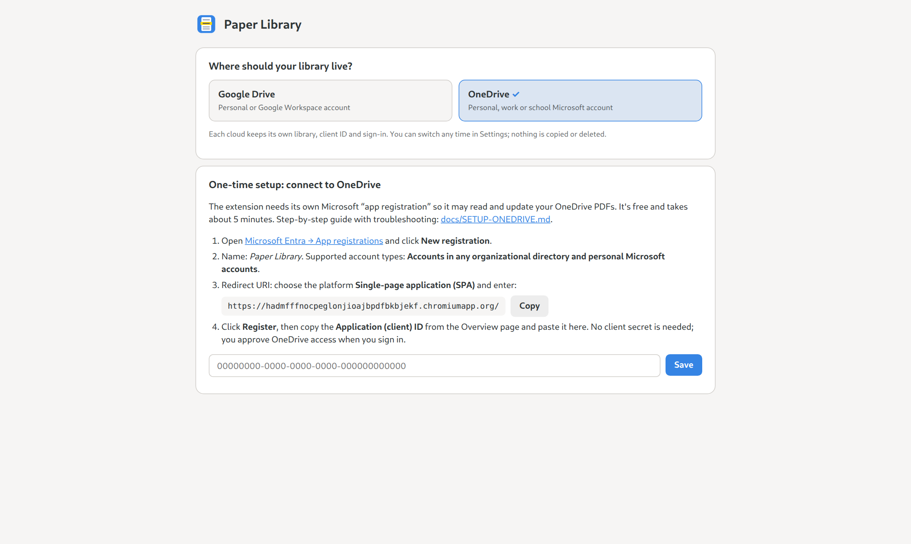

# Connecting the extension to OneDrive

This is a one-time setup and takes about 5 minutes. It works with **personal** Microsoft accounts
(outlook.com, hotmail.com, live.com…) and **work or school** accounts (OneDrive for Business).

## Why is this needed?

Microsoft lets an app read and change your OneDrive files only after you approve it at Microsoft
sign-in. To do that, Microsoft needs to know *which app* is asking, so every app has an
**Application (client) ID**, created by an "app registration".

Paper Library has no company or server behind it, so each user registers their own app (free).
The OneDrive permission you grant then belongs to *your own* registration, and nobody else can use it.
There is **no client secret**: the extension proves who it is with a one-time code (PKCE) at each sign-in.

> **Which Microsoft account?** You can register the app with one account and sign in to the extension
> with another, as long as the registration allows that kind of account (step 2).

## 1. Open App registrations

1. Open **Microsoft Entra admin center → App registrations**:
   <https://entra.microsoft.com/#view/Microsoft_AAD_RegisteredApps/ApplicationsListBlade>
   (the same page is in the Azure portal under *Microsoft Entra ID → App registrations*).
2. Sign in and click **New registration**.

> If Microsoft says your account needs a *directory* or *tenant* first, see
> [Troubleshooting](#microsoft-says-i-need-a-directory-or-tenant).

## 2. Register the app

| Field | Value |
|---|---|
| **Name** | `Paper Library` (anything you like) |
| **Supported account types** | **Accounts in any organizational directory (Any Microsoft Entra ID tenant - Multitenant) and personal Microsoft accounts (e.g. Skype, Xbox)** |
| **Redirect URI**: platform | **Single-page application (SPA)** ⚠️ not "Web" |
| **Redirect URI**: value | `https://hadmfffnocpeglonjioajbpdfbkbjekf.chromiumapp.org/` (also shown on the extension's setup page, with a Copy button) |

Click **Register**.

**Why these choices?**
- *Any directory + personal accounts* lets you sign in with either kind of account. The extension
  signs in through Microsoft's shared `common` endpoint, which needs this setting.
- *Single-page application* tells Microsoft that the app runs in the browser and can't keep a
  secret. Microsoft then accepts the PKCE proof instead of a client secret.
- The redirect URI is where Microsoft sends you back after sign-in. Chrome catches it and hands
  it to the extension. It's the same on every computer, because the extension's ID is fixed.

## 3. Copy the Application (client) ID

On the app's **Overview** page, copy **Application (client) ID**. It looks like
`1a2b3c4d-1234-5678-9abc-def012345678`.

You don't need to add API permissions or create a secret. The extension asks for these
permissions when you sign in, and you approve them on Microsoft's consent page:

| Permission | Why |
|---|---|
| `Files.ReadWrite` | Open your PDFs and save highlights back into them; create the *Paper Library* folder, collections and uploads |
| `User.Read` | Show which account is signed in |
| `offline_access` | Stay signed in for the day without asking again |

## 4. Connect the extension

1. Click the Paper Library icon. On the setup page choose **OneDrive**.
2. Paste the client ID and click **Save**.
3. Click **Sign in with Microsoft**, pick your account and **Accept** the permissions.

A folder called **Paper Library** appears in your OneDrive on first use.

## Keep your client ID for next time

Like the Google client ID: save it somewhere **private** (password manager, private note).
On a new computer you install the extension, choose OneDrive, paste the same ID and sign in.
Don't post it publicly. It isn't a password, but it identifies *your* app registration.

## What's stored where (OneDrive)

| What | Where |
|---|---|
| Papers | PDFs in `Paper Library/` and its sub-folders (= collections) |
| Highlights and notes | Inside each PDF, as standard annotations. OneDrive keeps old versions in *Version history*. |
| Title, authors, year, favourites, extra collections | `Paper Library/.paper-library.json` (a small text file; don't delete it, or the details have to be looked up again) |
| Trash | `Paper Library/.trash/`, until you restore the paper or **Delete forever** / **Empty Trash**. Paper Library asks OneDrive to skip its recycle bin; if OneDrive doesn't allow that for your account, it tells you and opens the recycle bin for you to empty. |
| Your sign-in | In your browser only (Chrome's session storage), cleared when Chrome closes |

Switching back to Google Drive (**Settings → Switch to Google Drive**) leaves all of this untouched.

## Troubleshooting

#### Microsoft says I need a directory or tenant
For example, when opening Entra with a personal account:
*"Selected user account does not exist in tenant 'Microsoft Services' and cannot access the application
'74658136-…'"* (that ID is Microsoft's own admin portal, not your app).

App registrations live inside a *directory* (tenant). Work and school accounts already have their
organisation's directory. Personal accounts all belong to one shared Microsoft tenant, where nobody can
register apps. First try opening <https://portal.azure.com> and searching for **App registrations**, which
can set up a directory for a personal account. If that doesn't work, there are two free ways around it:
- Sign up for a free Azure account at <https://azure.microsoft.com/free/>, which creates a directory for
  you, then register the app there (step 2 still lets your *personal* account sign in).
- Or register it with a work/school account whose organisation lets users register apps.

#### `AADSTS50011`: redirect URI mismatch
The redirect URI isn't registered exactly. Open the app → **Authentication** and check that it's
`https://hadmfffnocpeglonjioajbpdfbkbjekf.chromiumapp.org/` (with the final `/`) under
**Single-page application**.

#### `AADSTS9002326` or "Cross-origin token redemption is permitted only for the 'Single-Page Application' client-type"
The URI was added under **Web** instead of **Single-page application**. In **Authentication**, delete it
under *Web* and add it again under **Add a platform → Single-page application**.

#### `AADSTS50194` / "not configured as a multi-tenant application", or `unauthorized_client` for a personal account
The **Supported account types** setting is too narrow. Open the app → **Manifest** (or
**Authentication → Supported account types**) and choose *any organizational directory and personal
Microsoft accounts*. If the portal won't change it, register a new app with the right setting.

#### "Need admin approval" (work or school account)
Your organisation only allows apps an admin has approved. Ask IT to grant consent for your app
registration, or use a personal Microsoft account.

#### "Your OneDrive is full" / "Quota limit reached"
Sign-in worked, but OneDrive has no free space, so it refuses to create the *Paper Library* folder or
save anything. Free personal accounts have 5 GB, and Outlook.com email attachments count toward it.
Check and free space at <https://onedrive.live.com/?v=managestorage> (empty the OneDrive recycle bin
too: it still counts), then reload the library.

#### Sign-in worked yesterday, today it asks again
Normal after Chrome restarts and your Microsoft session in the browser has ended. Click **Sign in** once.

#### Downloads or uploads fail, and the console shows "Refused to connect … Content Security Policy"
OneDrive sent a file to a storage server the network lock doesn't know yet. Please
[open an issue](https://github.com/prajwalsingh/paper-library/issues) with the **host name only**
(e.g. `something.sharepoint.com`, never the full link: it contains a temporary access key).
