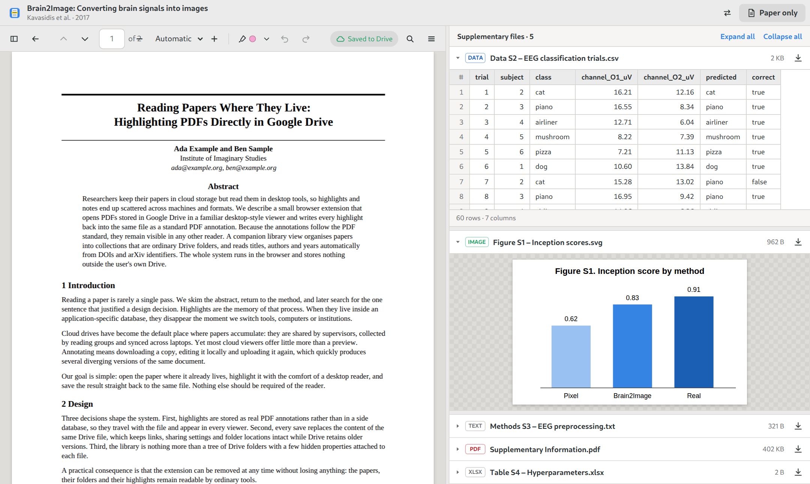

# 📎 Paper Library v2.2.0: Supplementary reading mode

> **Read a paper and its supplementary material side by side.** Attach supplementary files
> (extra figures, data tables, methods, videos…) to a paper, then open them next to it, several at once.
> Suggested by a computational biologist who reads papers with five supplementary files open in parallel. Thank you!



---

## ✨ What's new

### 📎 Attach supplementary files to a paper
In the library, select a paper. The details panel has a new **Supplementary files** section:
- **+ Add files**, or **drop files** onto the section. **Any file type** works.
- **Rename** ✏️ or **remove** ✕ a file. Removed files go to your cloud's trash / recycle bin, so they can still be restored there.
- Papers with supplementary files show a **📎 N** badge in the table. Click it to open the paper in supplementary reading mode.

### 🪟 Supplementary reading mode
**Open with supplementary (N)** opens a new tab:

| Left | Right |
|---|---|
| The paper, in the normal viewer, with highlights, notes and autosave as usual | An accordion of its supplementary files: **expand several at once**, collapse the rest |

- **Drag the divider** to share the width your way (double-click: half and half). **⇄** puts the paper on the other side. Both are remembered.
- **Drag the bar under an open file** to make it taller or shorter.
- **Paper only** goes back to normal reading.

### 🗂️ What opens inside the panel

| File | Shown as |
|---|---|
| **PDF** | The full viewer. **You can highlight supplementary PDFs too**, saved into those files |
| **Images**: PNG, JPG, GIF, WebP, SVG | Fit to the panel; click for actual size |
| **Data**: CSV, TSV | A table with a fixed header row and row numbers (first 2,000 rows) |
| **Text**: TXT, Markdown, JSON, code, FASTA, GFF, VCF, BED… | Plain text |
| **Video**: MP4, WebM | The browser's own player |
| **Everything else** (Word, Excel, TIFF, ZIP…) | A card with **Download** and **Show in Drive / OneDrive**. Word and Excel are planned for a later version |

### 📍 One small addition to the normal viewer
If a paper has supplementary files, the viewer's **☰ menu** gets **Open with supplementary (N)**. Nothing else in the normal reader changed.

---

## ☁️ Where the files are kept
In your own cloud, readable without the extension:

```
Paper Library/
├── Neuroscience/            ← your collections, as before
└── Supplementary/           ← not shown as a collection
    └── Brain2Image – Kavasidis 2017/
        ├── Supplementary Information.pdf
        ├── Data S2 – EEG trials.csv
        └── Movie S1.mp4
```

- The folder name is only for you. The link to its paper is the paper's **file ID**, so **renaming the paper or moving it** between collections keeps its files.
  - **Google Drive:** hidden properties on the folders and the paper.
  - **OneDrive:** `.paper-library.json`.
- **Trash** keeps a paper's supplementary files; **Restore** brings everything back.
  **Delete forever** removes them together with the paper (the confirmation tells you how many).
- Works the same on **Google Drive** and **OneDrive**.

---

## 🛡️ Network lock: what changed
**No new websites.** Two small changes to the Content Security Policy in `manifest.json`:

| Directive | Before | Now | Why |
|---|---|---|---|
| `frame-src` | `'none'` | `'self'` | The supplementary page shows the viewer in a frame. Only the extension's **own** pages may be framed; any website is still refused |
| `media-src` | *(default: `'self'`)* | `'self' blob:` | Videos play from memory after downloading from your cloud |

Check it yourself: `python3 scripts/audit.py` still prints **Unexpected hosts: none**.

---

## 🔧 Under the hood
- New `supp.html` / `supp.css` / `supp.js` (the reading mode) and `js/supplementary.js` (shared helpers).
- Both clouds offer the same new functions: `listSupplementary`, `uploadSupplementary`, `renameSupplementary`,
  `deleteSupplementary`, `suppCount`.
- The 📎 count is stored with the paper, so the table needs **no extra requests**. If you add or remove files
  in Drive / OneDrive directly, the count corrects itself the next time you open the paper's details.
- New automated test `dev/tests/drive.test.mjs` (fake Drive API); `dev/tests/onedrive.test.mjs` covers supplementary files too.

---

## ⬆️ How to update
In your Paper Library folder:
```bash
git pull
```
Then open `chrome://extensions` → **⟳** on Paper Library (needed this time: the network lock changed), and reopen any Paper Library tabs.
Your library, highlights and client IDs stay exactly as they are.

---

<sub>Paper Library is distributed **only** on <https://github.com/prajwalsingh/paper-library>. Copies elsewhere are not official.</sub>
